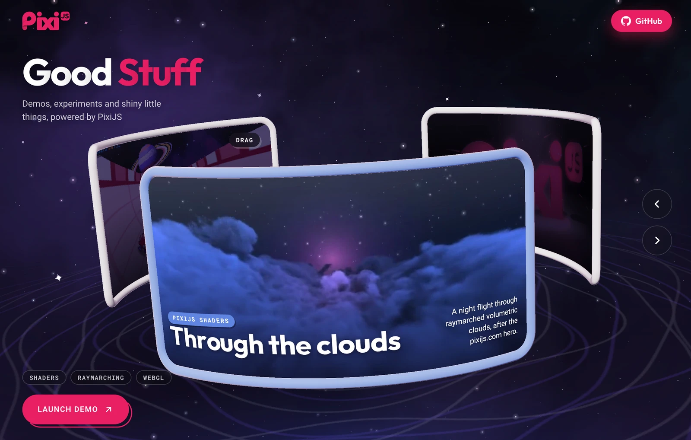

import { BlogSponsors } from '@site/src/components/Blog/BlogSponsors';

PixiJS 3D is here, and it's in open beta today.

<div style={{ maxWidth: 700, margin: '0 auto', paddingBottom: 24 }}>
  <a href="/images/blog/pixi-3d-open-beta.mp4" target="_blank" rel="noopener noreferrer">
    <video
      src="/images/blog/pixi-3d-open-beta.mp4"
      autoPlay
      loop
      muted
      playsInline
      style={{
        width: '100%',
        borderRadius: '12px',
        boxShadow: '0 0 20px hsla(340, 82%, 52%, 0.15)',
      }}
    />
  </a>
  <div style={{ textAlign: 'center', fontSize: '0.9em', opacity: 0.7, marginTop: 8 }}>Rendered live by PixiJS 3D. It's just the renderer rendering.</div>
</div>

PixiJS is now the only renderer on the web that's a full 2D engine and a full 3D engine at once. Both live on one stage, and you can go full tilt in both directions.

Already build with PixiJS? Add one `View3D` to your project and you're in 3D, with the `addChild`, `Assets`, and pointer events you already know. New here? Welcome. This is a good place to start.

{/* truncate */}

- **2D and 3D share a stage.** A 3D scene is a display object. Add one, or twelve, anywhere in your 2D scene.
- **Normal code is fast.** Write a scene the obvious way and it's quick. We benchmarked the different ways to render, and the engine picks the best one for your device, browser, and scene.
- **The good stuff is built in.** Shadows, animation, particles, post-processing, and the rest of what you'd expect from a 3D engine are all here.
- **It's WebGPU first.** We designed it around WebGPU, and the same code runs on WebGL2 for everyone else.
- **It's AI ready.** Your agent can write it from the first prompt, with new skills for 2D and 3D.
- **Best of all, it's free.** It's MIT licensed and it always will be, so enjoy.

---

## A new dimension for the project you already have

You don't port anything, and you don't run a second engine next to PixiJS. A 3D scene is a display object. Load a model, build a `View3D` from it, and add it to the stage:

```ts
import { View3D } from '@pixi/3d';
import { Assets } from 'pixi.js';

const source = await Assets.load('helmet.glb');
const view3d = View3D.from(source);

app.stage.addChild(view3d);
```

The view layers with everything else you draw, so you choose how much 3D you want. Keep your regular 2D workflow and drop in a 3D element where it helps, like a spinning trophy in a menu or a character in a shop screen. Or go the other way. Make one `View3D` fill the screen, build a whole 3D game inside it, and put your UI over the top as a regular 2D container.

Everything in between works too, and the mixing and matching is the powerful part. Filters and masks work on a 3D view. 3D objects take the same pointer events as sprites. glTF models load through `Assets`. Your 2D can follow your 3D, like a health bar over a character.

A `View3D` is a display object, so nothing stops you adding more of them. PixiJS is the only engine where you can put several 3D views in one 2D scene. Each has its own scene and camera, and you place and size each one like a sprite. Every card here is its own `View3D`:

<PixiExample name="2d3d_many-views" pkg="3d" />

It goes the other way too. You can draw any 2D container onto a 3D surface, live. Here a 2D scene with a bouncing wordmark and a clock runs on the screen of a 3D monitor:

<PixiExample name="2d3d_container-texture" pkg="3d" />

And since a `View3D` is a display object, that 2D container can hold one of its own. So the two [nest](/3d/guides/components/container-texture#nesting-a-view3d), anything inside anything, as many levels deep as you like. 3D in your 2D in your 3D in your 2D. It's all good.

The shelf of demos at [goodstuff.pixijs.io](https://goodstuff.pixijs.io) is built this way. Each of its screens is a 2D scene drawn onto a curved 3D panel.

<div style={{ maxWidth: 700, margin: '0 auto', paddingBottom: 24 }}>
  <a href="https://goodstuff.pixijs.io">
    
  </a>
</div>

[View3D and 2D content](/3d/guides/concepts/view3d) shows how far the two mix.

---

## Normal code is fast

PixiJS has always tried to make the default way of using it the fast way, and 3D is no different. You write a scene the obvious way, and it's fast.

Add five cubes that share a geometry and a material, and they draw in one instanced call. You didn't ask for that, and you shouldn't have to. There's no reason those cubes shouldn't batch, so why should you have to care? We take that on.

There's more to a renderer than instance counts, though. Drawing a million copies of one cube makes a good benchmark number, but nobody ships that game. A real scene is lots of different things. It has different models and materials, characters that animate, lights that cast shadows, and a HUD over the top, and much of it changes from frame to frame. That's where we spent our time and effort. We made PixiJS 3D fast for everything that isn't a number benchmark.

Part of that is accepting that no single way of drawing a scene is the fastest everywhere. What's quickest on a desktop GPU isn't always quickest on an iPhone, and a small scene wants different treatment from a huge one. So we benchmarked the different ways to render, and the engine picks the best path for your device, your browser, and your scene.

Culling shows how that plays out. On most WebGPU browsers it runs in a compute shader. In Safari, and on any iPhone or iPad, it runs on the CPU for a typical scene and moves to the compute shader once a batch gets big enough. You write the same code either way, and you never see the switch.

The engine also updates only the meshes that changed, so a scene that holds still costs the CPU little. These 100 crates in 100 colors are one draw call, and nothing in the code asks for that:

```ts
import { CubeGeometry, Material3D, Mesh3D } from '@pixi/3d';

const geometry = new CubeGeometry();

for (let i = 0; i < 100; i++) {
    const crate = new Mesh3D({
        geometry, // one geometry for every crate
        material: new Material3D({ baseColor: Math.random() * 0xffffff, roughness: 0.6 }),
    });

    crate.position.set((i % 10) * 1.5, 0.5, Math.floor(i / 10) * 1.5);
    view3d.root.addChild(crate);
}
```

The big numbers are there when you want them. For a forest or a crowd, `BatchedMesh3D` draws tens of thousands of copies from one node. This is 100,000 objects with shadows, all at 60 fps:

<PixiExample name="instancing_batched-mesh" pkg="3d" />

The [performance guide](/3d/guides/concepts/performance) has the details.

---

## A modern architecture for a modern web

WebGPU is where the web is going, so that's where we built PixiJS 3D to be. We had a head start too. We built PixiJS v8 with exactly this in mind, so most of the groundwork was already done, and 3D gets to use the exciting new techniques on top of it.

Whether it's render bundles, indirect draws, or culling in a compute shader, we've used every modern technique that we measured to be faster and that's ready for today's web.

Compute shader culling is a great example. It wasn't available to us before, and it can really speed up large scenes without eating your CPU.

But don't think for a second that we've forgotten our good old friend WebGL. That side of the engine is just as optimised, and we put just as much love into it, so every game works while the web makes the move to WebGPU.

The same scene code runs on both, and each browser downloads only the backend it uses. Ask for WebGPU when you start the app, and PixiJS falls back to WebGL2 where it's missing:

```ts
await app.init({ preference: 'webgpu' });
```

---

## It should just work

We won't make a song and dance about this part. Everything you'd expect when you're building something fun on the internet is in there.

You get glTF models with skinning, morph targets, animation, and compressed textures. Materials are PBR, Phong, flat, or toon, or you can make your own, including multi-pass materials! There's a render graph, HDR, tone mapping, post-processing, particles, shadows, and cascaded shadows. It's the stuff people just expect, and we've optimised and tuned it as far as we can take it.

Turning something on is an option you set. This is a sun that casts cascaded shadows:

```ts
const sun = new DirectionalLight({
    intensity: 3,
    castShadow: true,
    shadow: { cascades: 3 }, // sharp shadows near the camera, however big the world is
});
```

The whole engine is built to be extended too. When you need something we didn't think of, you can write your own materials, shader code, and post effects. Or if you're feeling really fancy, create your own custom render graph.

---

## Made for games

We built PixiJS 3D to make games, so we made one.

Twelve animated characters from one model file draw in one call. Your HUD, menus, and touch controls are real PixiJS on the same stage, so there's no DOM overlay to keep in sync and no second UI library to learn.

[Mach 2](https://goodstuff.pixijs.io/mach-2/) is a half-pipe runner built on PixiJS 3D. You steer round the pipe, jump, and collect cubes through five zones, with a PixiJS 2D HUD over the run. It plays on WebGPU or WebGL2, with a keyboard or on a phone:

<div style={{ maxWidth: 700, margin: '0 auto', paddingBottom: 24 }}>
  <a href="https://goodstuff.pixijs.io/mach-2/">
    <video
      src="/images/blog/pixi-3d-mach-2.mp4"
      autoPlay
      loop
      muted
      playsInline
      style={{
        width: '100%',
        borderRadius: '12px',
        boxShadow: '0 0 20px hsla(340, 82%, 52%, 0.15)',
      }}
    />
  </a>
</div>

Mach 2 lives on [Good Stuff](https://goodstuff.pixijs.io), which is where we'll keep adding our 3D experiments. Definitely go and check it out for more cool stuff.

Want to see how a full game fits together? We also made everybody's favourite little kitbash racing game, and [the source is here](/3d/examples?example=game_racing). The [shooting gallery tutorial](/3d/tutorials/shooting-gallery) builds a small game step by step in a live editor.

---

## Ready for your AI agent

PixiJS 3D works really well with agents. We built a lot of stuff with them, and they take to PixiJS 3D like a duck to water. From that we built the PixiJS skills, which help your agent even more.

There's a bonus too. Agents write normal code, and normal code is fast here. The engine does the batching and culling under the hood, so the apps your agent builds perform well without it knowing any tricks.

The `pixijs-3d` skill ships with PixiJS 3D. It has a complete starting app and a runnable recipe for each job, such as loading a glTF model or adding post-processing. It also lists the mistakes that throw no error but draw the wrong picture.

One command installs it next to the PixiJS skill, in Claude Code, Cursor, Codex, or Copilot:

```bash
npx skills add https://github.com/pixijs/pixijs-skills
```

The skill also ships inside the npm package, so it always matches the version you installed, and the 3D docs are published as llms.txt. See [pixijs.com/llms](/llms) for everything PixiJS has for AI tools.

---

## Start building today

Install it next to `pixi.js`:

```bash
npm install pixi.js @pixi/3d
```

`@pixi/3d` needs `pixi.js` 8.23.0 or later. Import it before `app.init` runs, add a `View3D` to the stage, and you have a scene. This one is a lit cube that you can drag to orbit:

```ts
import { CubeGeometry, DirectionalLight, Material3D, Mesh3D, View3D } from '@pixi/3d';
import { OrbitCamera } from '@pixi/3d/extras';
import { Application } from 'pixi.js';

const app = new Application();

await app.init({ preference: 'webgpu', background: '#1a1a2e', resizeTo: window, antialias: true });
document.body.appendChild(app.canvas);

// A View3D draws a 3D scene. Its environment lights the scene from above and below
const view3d = new View3D({ autoResize: true, environment: { skyColor: 0xc9d6ff, groundColor: 0x3a2f45 } });

app.stage.addChild(view3d);

// A red cube, and a sun shining on it
const cube = new Mesh3D({ geometry: new CubeGeometry(), material: new Material3D({ baseColor: 0xdd4444 }) });
const sun = new DirectionalLight({ intensity: 3 });

sun.position.set(-3, 5, 2);
view3d.root.addChild(cube, sun);
sun.lookAt(cube.position);

// Move the camera back, and let a drag orbit it around the cube
view3d.camera.position.set(0, 1.5, 4);
new OrbitCamera({ view: view3d });

app.ticker.add((time) => {
    cube.rotation.y += 0.01 * time.deltaTime;
});
```

The docs are ready too, with [35 guides](/3d/guides/getting-started/intro), [over 100 live examples](/3d/examples), [three tutorials](/3d/tutorials) that run in a live editor, and an [API reference](https://3d.pixijs.download/release/docs/index.html).

We're in beta, so the API can still change before 1.0 and you may hit a few rough edges. If you find an issue, please [open one up](https://github.com/pixijs/3d/issues). We're actively working on this and we'll fix things as they come up.

We've built this site's 3D pages, Mach 2, and every one of those examples on it, and now we want to see what you build. Come and show us on [Discord](https://discord.gg/QrnxmQUPGV).

---

## PixiJS, now in three dimensions

PixiJS 3D is the biggest addition to PixiJS since v8.

So many of you build with PixiJS, and we love that. We love seeing what you make with it, and it's the reason this exists. We're so happy we get to give you a new dimension. Thank you.

Now go and add a `View3D` to something.

- Start with the [quick start](/3d/guides/getting-started/quick-start), the [examples](/3d/examples), or a [tutorial](/3d/tutorials)
- See our 3D experiments on [Good Stuff](https://goodstuff.pixijs.io), with more on the way
- [Submit your project to the Showcase](https://pixijs.com/showcase)
- Follow us on [Twitter](https://x.com/PixiJS) / [Bluesky](https://bsky.app/profile/pixijs.com)
- [Sponsor PixiJS](https://pixijs.com/sponsor)

---

## Thank you to our sponsors

PixiJS is made possible by our sponsors. A special thanks to our Silver tier and above supporters; you can [join them](https://pixijs.com/sponsor) and keep the engine moving.

<BlogSponsors />

<br />

Happy creating!

**The PixiJS Team**
